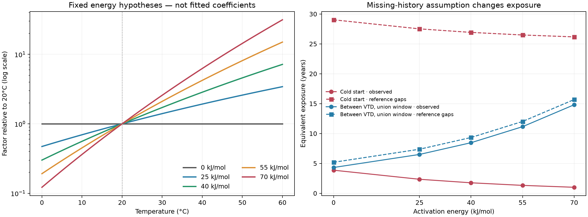

# Stage 03 — fixed activation-energy candidate review

Completed on local branch `model_v02`, HEAD
`8770be9693de299f0b9b4c27db1ad7ae9ce517af`. This is a sensitivity study, with
**zero fitted models and no selected winner**. All five candidates are retained
for testing. The exact preregistration and its checksum accompany the results.

## Reproduce

From the repository root, using the virtual environment prepared in Stage 02:

```bash
.venv/bin/python -m experiments.temperature_v02_03.run
.venv/bin/python -m unittest discover -s tests -v
.venv/bin/python -m experiments.temperature_v02_03.verify
```

The runner only writes inside `experiments/temperature_v02_03`. The tests inspect
the committed-style evidence files, so run the computation first after removing
generated artifacts. `verify` independently regenerates all 13 data/graph outputs
in a temporary stage directory and compares bytes; it also checks all 152 files
in the pre-work preservation inventory. That inventory must not be rewritten to
make a failed check pass. No parser, preprocessing configuration, Stage 02 code,
existing test, baseline prediction or official submission was modified.

## Preregistered hypotheses and units

Full precision is used in calculations and CSV exports:
`R=8.314462618 J/(mol·K)`, `T_ref=293.15 K`, `theta_K=1000*E_a_kJ_mol/R`,
`F_T=exp(theta_K*(1/T_ref - 1/T_K))`, `T_K=t_mix_usable+273.15`.
The displayed theta/factors below are rounded, not the calculation inputs.

| Candidate | Ea, kJ/mol | theta, K | F(20°C) | F(40°C) | F(58.16°C) | Reason to retain |
|---|---:|---:|---:|---:|---:|---|
| EA00_null | 0 | 0 | 1 | 1 | 1 | Negative control: no thermal response; checks duration/gap identities |
| EA25_low | 25 | 3006.808876 | 1 | 1.925294 | 3.258870 | Low effective temperature sensitivity |
| EA40_mid | 40 | 4810.894202 | 1 | 2.852301 | 6.620749 | Provisional engineering hypothesis, with no preference from validation |
| EA55_elevated | 55 | 6614.979527 | 1 | 4.225651 | 13.450776 | Elevated sensitivity between the provisional midpoint and stress case |
| EA70_high | 70 | 8419.064853 | 1 | 6.260252 | 27.326721 | Stress test for hot observations and extrapolation |

The five values are `team_hypothesis`, not measured or fitted activation energies.
The compatibility control is separate: `theta=2500 K`,
`Ea=20.786156545 kJ/mol`, `source_type=legacy_placeholder`. The legacy function
was compared once with the new factor formula on all 3,000 pooled valid
production observations, using the same temperatures and no fallbacks. Maximum
absolute difference was **0.0**. This proves scalar compatibility only.

Okafor, Brown & Nesic reported 31.26 kJ/mol without acetic acid and 73.29 kJ/mol
with it for their X65 laboratory system. These chemistry-dependent apparent
energies provide context; neither is a PipeTwin measurement or candidate, and
they do not validate 40 kJ/mol. The original article was checked, including its
40–80°C calculation and Table 1 conditions.
[Original paper, DOI 10.1007/s10800-008-9733-x](https://www.icmt.ohio.edu/documents/Journals2009/CO2%20Corrosion%20of%20Carbon%20Steel%20in%20The%20Presence%20of%20Acetic%20Acid%20at%20Higher%20Temperatures.pdf).

## Frozen histories, windows and aggregation

The existing `RepositoryData`, `make_snapshot`, `build_training_windows` and
`eligible_training` APIs supply checksum-verified, cutoff-specific data. Hydraulic
QA is computed at each window's own cutoff. The Stage 02 T-only interval builder
is called once per window. Every candidate then uses that same interval object;
`interval_sha256` makes this identity auditable. Hold cap: **one day**, bounded by
the next record (even invalid), start and cutoff. No record on or after the cutoff
is used. No W/v validity gate or spatial-temperature fallback is imposed.

Production has 525 between-VTD segments at 2023-12-01 and 1,475 cold-start segments
at 2022-07-01. The between-VTD segments have two legitimate start dates, retained
as separate windows. Historical candidate diagnostics use only target-specific
eligible training rows: **357 between-VTD + 372 cold-start = 729**. Excluded are
the 53 target-date rows, 94 later cold-start rows, and 204 between-VTD rows without
an eligible measured prior baseline. No labels are exported into the feature or
factor tables. The cold-start target's parent is excluded from its training pool.

The outputs have **11 window groups × 5 candidates = 55 exposure rows**:
six eligible historical windows, three actual production windows, and two
production-union windows used for the compact candidate review. `window_segments.csv`
maps actual windows back to the exact 729 historical and 2,000 production keys;
it does not replicate union windows per segment.

For the exact-schema `ea_candidate_review.csv`, the scope is the **union of
production forecast windows within each target section**: earliest permitted
start to its cutoff. Thus section 1250022871 contributes 2018-09-23 → 2023-12-01
once, and section 1250009583 contributes 1993-06-20 → 2022-07-01 once. There is no
overlapping-window or segment duplication. This scope is a descriptive pooled
review, not the horizon of every individual segment. The three actual production
windows and six training windows remain separately available for downstream use.

The pooled review contains **3,000 contributing timestamps** (1,585 + 1,415),
**8.179450719 supported section-years**, and **23.90418%** coverage. Coverage is
the sum of supported durations divided by the sum of the two union horizons;
it is not an average across segments. Each valid contributing timestamp gets one
weight for mean/min/p95/max; p95 uses NumPy's linear quantile. The separate
duration-weighted mean is `sum(duration*F)/sum(duration)` and is exported in
`factor_statistics.csv`. Serially correlated timestamps are not independent
physical experiments.

Both gap assumptions are reported for identical support:

- Observed-only: `E_obs=sum(duration_years*F)`. Missing history is unknown.
- Reference gaps: `E_reference=E_obs+H_gap`, explicitly assuming `F_gap=1`.

The exposure CSV puts both integrals alongside support, missingness and policy
metadata; the review CSV has ten rows (five candidates × two named gap policies).
Reference filling is never included in the observed factor distributions.
Empty histories would have observed integral/coverage zero, null observed mean,
and a reference integral based solely on the declared assumption. CSV nulls are
empty fields; `ea_candidate_review.json` uses actual JSON `null`.

## Measured-history factor sensitivity

Pooled production-union observations, with no segment replication:

| Candidate | Minimum F | Mean F | p95 F | Maximum F |
|---|---:|---:|---:|---:|
| EA00_null | 1.000000 | 1.000000 | 1.000000 | 1.000000 |
| EA25_low | 0.471891 | 1.082673 | 1.750025 | 2.207361 |
| EA40_mid | 0.300709 | 1.251711 | 2.448334 | 3.549746 |
| EA55_elevated | 0.191624 | 1.528117 | 3.425288 | 5.708490 |
| EA70_high | 0.122111 | 1.939319 | 4.792075 | 9.180053 |

All factors in every audited window are finite and strictly positive; overflow
and underflow counts are zero. The implementation raises on overflow/underflow
instead of silently clipping. Real contributing temperatures range from 0°C to
44.5233°C in production, and up to 43.633411°C in the eligible historical windows.
**58.16°C is an illustrative sensitivity point beyond these window maxima**;
it is not inserted into any observed history.

70 kJ/mol gives greater amplification above 20°C and stronger suppression below
20°C. Its 27.33 factor at 58.16°C is relative to the same assumed reference rate;
it does not prove a 27-fold increase in actual pipe corrosion. If the reference
rate were later fitted separately, that rate could compensate for much of the
change in exposure. Hot outliers and extrapolated temperatures would carry more
influence, while unmodelled chemistry or protective films could invalidate the
simple monotonic assumption.



The graph is available as PNG and SVG. It shows the two production-union windows;
actual segment-window exposures are in `candidate_exposures.csv`.

At EA40_mid, observed/reference exposures are **8.463689 / 9.335872 years** for
the between-VTD union and **1.755660 / 26.921685 years** for cold start. The latter
contains **25.166025 unobserved years** and only **13.3086%** support. Increasing
Ea from 0 to 70 changes cold-start observed exposure from 3.863407 to 1.005365
years, but its reference-gap value stays between 29.029432 and 26.171390 years.
The assumed gap contribution dominates the result.

## Validation audit

| Production scenario | Available test campaign | Test rows | Earlier rows from a different parent | Admissible folds |
|---|---|---:|---:|---:|
| between_vtd, cutoff 2023-12-01 | MAIN-2, 2022-07-06 | 561 | 0 | 0 |
| cold_start, cutoff 2022-07-01 | MAIN-2, 2018-09-23 | 372 | 0 | 0 |

The fold audit uses the same-case forward-time and held-parent semantics of the
existing evaluation code. Same-day and later labels cannot train a fold. Each
production scenario has one eligible training parent (MAIN-2), but neither test
campaign has an earlier independent training group. The review's
`training_parent_count=1` means an available production-training parent, not a
fitted model. `validation_fold_count=0`, all prediction metrics are null,
`evidence_status=diagnostic_only`, and no `r_ref_mm_year` was calibrated.

If a future dataset creates an admissible fold, this version deliberately stops
after the fold audit. It must then be extended to perform W1 training-only rate
calibration and held-out metrics; it cannot silently label the new data as still
unavailable. A synthetic counterexample tests that the gate detects such a fold.

## Why E_a is presently unidentifiable

For a section/window sharing the same temperature history, the model's loss
would depend on the product `r_ref * E(Ea)`. A change in Ea can be offset by a
different reference rate. Replicating this one exposure across many segment
labels does not supply a new temperature trajectory. The available production
training pools each have only one parent and one campaign. The two parent-held
forward opportunities have no training data. A good-looking exposure curve or
an in-sample rate fit cannot resolve that lack of independent evidence.

The cold-start support gap adds another unobserved component: assigning it
reference temperature contributes 25.17 equivalent years regardless of Ea.
Neither the thermal history nor a confidence interval for that assumption can
be recovered from the observed timestamps.

Temperature also covaries with operating state. Pairwise descriptive Pearson r
on valid contributing production-union timestamps is:

| Pipe | T vs watercut | T vs velocity | T vs elapsed observation time |
|---|---:|---:|---:|
| 1250022871 | 0.0434 (n=1,585) | 0.1578 (n=1,585) | 0.6981 (n=1,585) |
| 1250009583 | -0.1355 (n=1,415) | **0.8677 (n=1,414)** | -0.3448 (n=1,415) |

These correlations describe association, not causation or independent sample
sizes. In particular, the strong cold-start T/velocity association makes an
effective Ea vulnerable to absorbing flow effects. Unmeasured chemistry and
film behaviour can also change apparent kinetics. No chemistry, viscosity or
additional flow multiplier was invented or fitted here.

## Decision and handoff

Retain all five predeclared candidates for testing. No winner and no narrowed
grid are justified by these diagnostics. A later prospective study should add
independent parent pipelines and inspection campaigns, longer measured thermal
histories, and temperature variation that can be separated from flow/chemistry.
Any future grid narrowing must be preregistered and supported by such validation.

**GO for Stage 04 as an explicitly exploratory, training-only rate experiment.**
**NO-GO for selecting a validated Ea, claiming improved accuracy, or replacing
the preserved baseline.** There is no Stage 03 execution blocker; missing
independent validation is a scientific limitation, not a hidden metric result.
